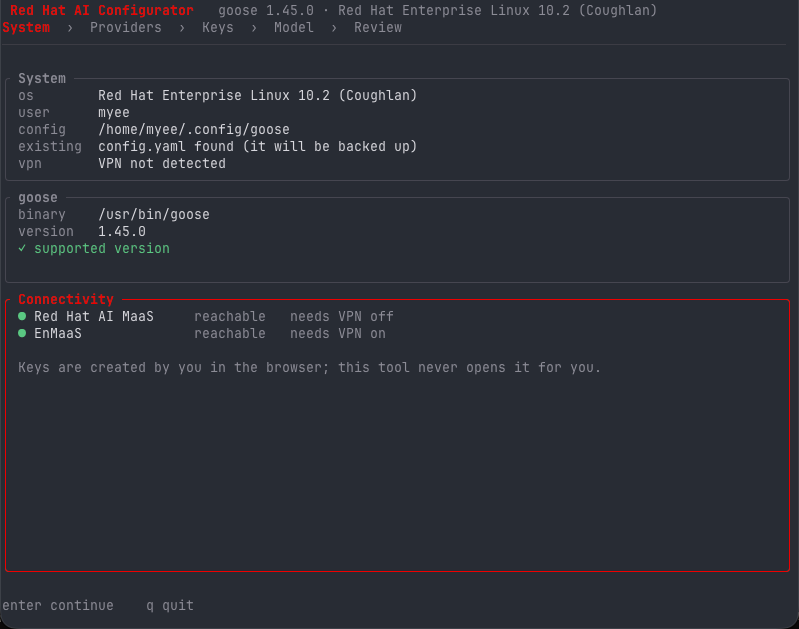

# Red Hat AI Configurator

A terminal installer that configures the [goose](https://github.com/aaif-goose/goose)
AI agent for two model services: a ratatui TUI for people, and
`--non-interactive` for Ansible and image builds. It validates each key before
writing anything, backs up every file it replaces, and verifies the result with
`goose info --check`.

| Provider | Internal name | goose engine |
|---|---|---|
| Red Hat AI MaaS | `rhai-maas` | OpenAI compatible |
| EnMaaS | `enmaas` | Anthropic compatible, plus an OpenAI-compatible provider for Gemini |

Red Hat AI MaaS needs the corporate VPN **off**; EnMaaS needs it **on**. The
installer shows the required state at each step.

Service endpoints and API keys are **not embedded**. Endpoints come from flags,
the environment, or `/etc/redhat-ai-configurator/endpoints.conf`; keys come from
the environment or a key file. See [Reference](#reference) for the details.



*Preflight: host checks, goose version, VPN state and service reachability.*

## Install

RHEL 10.2 (x86_64 or aarch64) with the RHEL extensions repository, which
provides `goose`:

```sh
sudo subscription-manager repos --enable=rhel-10-for-$(arch)-extensions-rpms
sudo dnf install ./redhat-ai-configurator-0.1.3-1.el10.x86_64.rpm
```

`goose >= 1.38` is required (the RPM declares the dependency). Install
`libsecret-tools` only if you want keys in the system keyring instead of
`secrets.yaml`.

Run it **as yourself**, not as root:

```sh
redhat-ai-configurator
```

## Interactive use

The TUI walks through five screens:

1. **System** — OS, user, configuration directory, `goose` version, VPN state,
   endpoint warning, and service reachability.
2. **Providers** — space to toggle, enter to continue.
3. **Keys** — the key page, the VPN requirement, and a masked input. Enter
   validates; if a key is already stored, enter keeps it and `ctrl+u` clears it.
4. **Model** — default model per provider, goose mode, and key storage.
5. **Review** — the files that will be written. Enter applies.

`esc` goes back, `ctrl+c` quits, and the recap stays in scrollback.

## Non-interactive use

```sh
export RHAI_MAAS_BASE_URL=https://maas.internal/v1
export ENMAAS_BASE_URL=https://enmaas.internal
export RHAI_MAAS_API_KEY=...
export ENMAAS_API_KEY=...

redhat-ai-configurator --non-interactive \
  --provider rhai-maas,enmaas \
  --format json
```

### Keys

The environment is read first:

```sh
export RHAI_MAAS_API_KEY=...
export ENMAAS_API_KEY=...
```

or pass a key file instead:

```sh
# keys.env, mode 0600, owned by you
RHAI_MAAS_API_KEY=...
ENMAAS_API_KEY=...

redhat-ai-configurator --non-interactive --provider rhai-maas --key-file keys.env

# or from stdin, for a secret manager
printf 'RHAI_MAAS_API_KEY=%s\n' "$KEY" |
  redhat-ai-configurator --non-interactive --provider rhai-maas --key-file -
```

- An environment value wins over the same name in the key file; the report says
  `"keySource": "env"`.
- An unset or blank variable counts as absent, so `--key-file` or, with
  `--keep-existing`, a stored key is used instead.
- `ENMAAS_API_KEY` also serves the `enmaas-openai` (Gemini) provider.
- The TUI does **not** read these variables; paste the key there instead.
- Values are written to `secrets.yaml` as given (validation ignores whitespace),
  so avoid stray spaces or newlines.

### Common flags

| Flag | Purpose |
|---|---|
| `--provider ID` | `rhai-maas`, `enmaas`, or both, comma separated |
| `--rhai-maas-base-url URL` | base for rhai-maas, including `/v1` |
| `--enmaas-base-url URL` | host root for enmaas, without `/v1` |
| `--key-file PATH` | read `NAME=value` lines from PATH, or `-` for stdin |
| `--keep-existing` | reuse stored keys; makes repeat runs idempotent |
| `--dry-run` | print the planned changes, write nothing |
| `--no-validate` | skip the network check (offline image builds) |
| `--require-validation` | fail instead of warning, and refuse placeholder endpoints |
| `--model PROVIDER=MODEL` | choose the default model |
| `--format json` | machine-readable output |

`--mode`, `--keyring`, `--no-verify`, `--rollback-on-failure`, `--list-models`,
`--doctor` and `--config-dir` are documented in `man redhat-ai-configurator`.

### Ansible

The module must run as the user who owns the goose configuration:

```yaml
- name: Configure goose for the AI MaaS providers
  ansible.builtin.command:
    argv:
      - /usr/bin/redhat-ai-configurator
      - --non-interactive
      - --provider
      - rhai-maas,enmaas
      - --format
      - json
  environment:
    RHAI_MAAS_API_KEY: "{{ rhai_maas_key }}"
    ENMAAS_API_KEY: "{{ enmaas_key }}"
    RHAI_MAAS_BASE_URL: "{{ rhai_maas_base_url }}"
    ENMAAS_BASE_URL: "{{ enmaas_base_url }}"
  become_user: alice
  register: cfg
  changed_when: (cfg.stdout | from_json).changed
  no_log: true
```

A single run can usually validate only one provider when the two services want
opposite VPN states. The other provider is reported as `"validated": false`
with a warning; add `--require-validation` to make that a failure instead.

## Reference

### Endpoints

Resolution order: command-line flags, then environment, then
`/etc/redhat-ai-configurator/endpoints.conf`, then the placeholder defaults.
The flags are checked strictly (scheme and `/v1` shape) and exit `2` when they
are wrong; values from the environment or the file only warn.

**Only two settings are mandatory, and only for the provider you configure:**

| Variable | Required | Meaning | Default |
|---|---|---|---|
| `RHAI_MAAS_BASE_URL` | **Yes, when configuring `rhai-maas`** | OpenAI-compatible base, including `/v1` | `https://maas.example.com/v1` |
| `ENMAAS_BASE_URL` | **Yes, when configuring `enmaas`** | Anthropic-compatible root, **without** `/v1` | `https://enmaas.example.com` |

Everything below only changes what the installer shows; none of it is needed
for a working configuration:

| Variable | Required | Meaning | Default |
|---|---|---|---|
| `RHAI_MAAS_KEY_PAGE` | Recommended | Page where users create a key | `https://maas.example.com/keys` |
| `RHAI_MAAS_HELP_URL` | Recommended | Help link shown in the UI | `https://maas.example.com/docs` |
| `ENMAAS_KEY_PAGE` | Recommended | Page where users create a key | `https://enmaas.example.com/keys` |
| `ENMAAS_HELP_URL` | Recommended | Help link shown in the UI | `https://enmaas.example.com/docs` |
| `ENMAAS_ELIGIBILITY_URL` | Optional | Access-request page; hidden when unset | unset |
| `ENMAAS_SLACK` | Optional | Help channel; hidden when unset | unset |

Notes:

- If you configure only one provider, you do not need any variable for the
  other one.
- Key pages and help links are not required to run, but leaving them at
  `example.com` gives users a dead link, so set them in practice.
- The whole file is optional. Omitted or blank values fall back to the default;
  a blank base URL is **not** a way to disable a provider — just do not
  configure that provider.

The same keys work in the config file:

```ini
# /etc/redhat-ai-configurator/endpoints.conf
RHAI_MAAS_BASE_URL=https://maas.example.com/v1
ENMAAS_BASE_URL=https://enmaas.example.com
```

When a selected provider's base is still a placeholder, the UI and `--doctor`
warn, and the non-interactive report includes a warning.
`--require-validation` turns that warning into a usage error (exit `2`) so
automation cannot write a `config.yaml` that points at `example.com`.
`--doctor` only checks the providers referenced by the existing `config.yaml`.

For one run, skip both files:

```sh
redhat-ai-configurator --non-interactive --provider rhai-maas,enmaas \
  --rhai-maas-base-url https://maas.internal/v1 \
  --enmaas-base-url https://enmaas.internal \
  --key-file -
```

### Exit codes

| Code | Meaning |
|---|---|
| `0` | Success, or a successful dry run |
| `1` | Unexpected error |
| `2` | Usage: bad flag or base URL, placeholder endpoint with `--require-validation`, no provider, or no TTY without `--non-interactive` |
| `3` | `goose` is missing or older than 1.38 |
| `4` | A key is missing, unreadable, or rejected |
| `5` | A service is unreachable (network or VPN) |
| `6` | A configuration file could not be written |
| `7` | Written, but `goose info --check` failed |

### What gets written

```
~/.config/goose/
├── config.yaml                         # merged, backed up
├── custom_providers/
│   ├── rhai-maas.json                  # engine: openai
│   ├── enmaas.json                     # engine: anthropic
│   └── enmaas-openai.json              # engine: openai (Gemini)
└── secrets.yaml                        # 0600, only when file storage is used
```

`config.yaml` gets both the flat keys that goose 1.38 reads and the structured
`active_provider` / `providers:` block that newer releases prefer:

```yaml
GOOSE_PROVIDER: rhai-maas
GOOSE_MODEL: publishers/prelude-maas/models/glm-53-flash
GOOSE_MODE: approve
GOOSE_DISABLE_KEYRING: true
active_provider: rhai-maas
providers:
  rhai-maas:
    enabled: true
    configured: true
    model: publishers/prelude-maas/models/glm-53-flash
```

Everything else in the file, including extensions, is preserved. Existing
files are copied to `<name>.bak-YYYYMMDD-HHMMSS` before being replaced, and a
file is only rewritten when its content actually changes, so repeated runs are
idempotent.

Every model entry declares a `context_limit`. goose 1.45 requires that field
and rejects the entire `custom_providers` directory if any single file omits
it, so the configurator always writes it (200000 for most models, 1000000 for
GLM, DeepSeek and Gemini).

### Troubleshooting a 500 from EnMaaS

A `500` from EnMaaS is the **service failing, not your key being rejected**. The
installer treats it that way: it shows the response body, and in the TUI you can
continue past it (in non-interactive mode it becomes a warning unless you pass
`--require-validation`, which exits `5`).

Check these in order:

1. **Base URL shape.** `ENMAAS_BASE_URL` is the host root, without `/v1`:
   `https://enmaas.example.com`. goose appends `v1/messages`, and the Gemini
   provider appends `/v1`. If you include `/v1`, requests become
   `/v1/v1/messages`.
2. **Model routing.** The Anthropic route may return 500 for a model the gateway
   cannot route. Try a Claude model (`claude-haiku-4-5`) before assuming the key
   is bad, and run `--list-models` to see what the service currently offers.
3. **A broken `/models` endpoint.** It is possible for `GET /v1/models` to fail
   while `POST /v1/messages` works. If the body says nothing about auth, run with
   `--no-validate` and test a real session with `goose`.
4. **VPN.** EnMaaS needs the corporate VPN on. A proxy in the way can produce a
   500 instead of a clean network error.

Capture what the gateway actually says:

```sh
curl -sS -i "$ENMAAS_BASE_URL/v1/models" \
  -H "x-api-key: $ENMAAS_API_KEY" \
  -H 'anthropic-version: 2023-06-01'

curl -sS -i "$ENMAAS_BASE_URL/v1/messages" \
  -H "x-api-key: $ENMAAS_API_KEY" \
  -H 'anthropic-version: 2023-06-01' \
  -H 'content-type: application/json' \
  -d '{"model":"claude-haiku-4-5","max_tokens":16,"messages":[{"role":"user","content":"hi"}]}'
```

Then confirm what goose thinks it is using:

```sh
goose info --verbose
cat ~/.config/goose/custom_providers/enmaas.json
tail -n 50 ~/.local/state/goose/logs/*/*.log
```

### Security

- Keys are never printed, logged, or included in JSON output.
- Keys are never read from command-line arguments: `argv` is visible to other
  users through `ps` and `/proc/<pid>/cmdline`. The environment (readable only
  by the same user and root) or a key file is the supported route.
- `secrets.yaml` is mode 0600 in a 0700 directory.
- `--key-file` refuses group- or world-readable files and reports only line
  numbers for malformed content.
- The tool never creates API keys, opens a browser, or reads the clipboard.
- The tool refuses to run as root (`--allow-root` exists for containers).
- Keyring storage uses goose's own Secret Service entry through `secret-tool`,
  and falls back to the file with a warning if the keyring is unavailable.

### Build

```sh
cargo build --release --locked
cargo test --locked
cargo clippy --all-targets -- -D warnings
```

Rust 1.88 or newer is required; RHEL 10.2's Rust 1.92 works.

#### RPM

`cargo vendor` is used so the build is offline and reproducible:

```sh
make tarballs     # source and vendor tarballs in dist/
make rpm          # rpmbuild -ba, output in dist/rpmbuild/RPMS/
```

On a clean RHEL 10 host:

```sh
sudo dnf install -y cargo rust gcc make rpm-build rpmdevtools
make rpm
```

### Layout

```
src/main.rs        entry point, exit codes
src/cli.rs         flags, non-interactive flow, doctor, list-models
src/apply.rs       shared plan/commit core
src/tui.rs         ratatui screens and event loop
src/catalog.rs     providers, models, endpoint accessors
src/settings.rs    endpoint resolution (flags, env, config file, defaults)
src/netcheck.rs    key validation, model discovery, reachability
src/goose/         config.yaml, custom providers, secrets, goose runner
src/platform.rs    OS, goose discovery, VPN detection
packaging/         RPM spec, man page, example endpoints file
tests/             end-to-end CLI tests
```

## License

MIT. See `LICENSE`.
